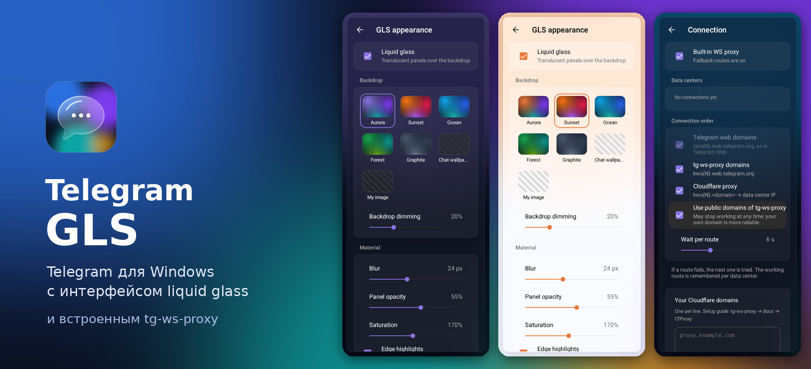
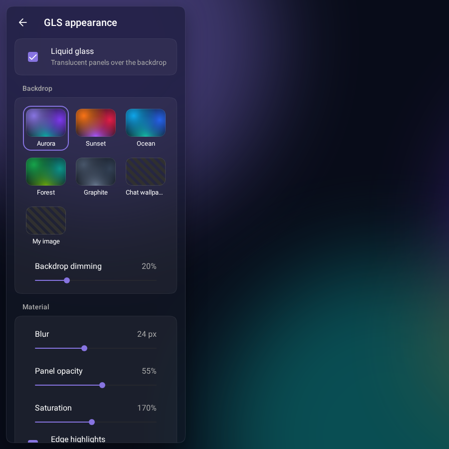
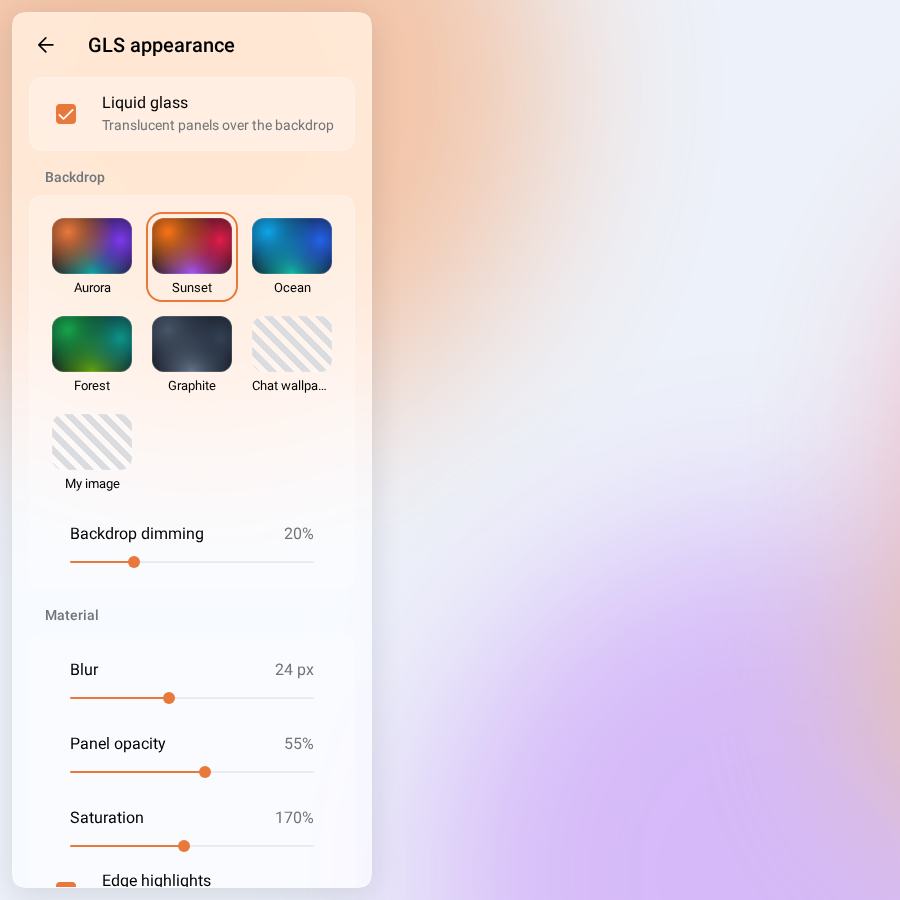
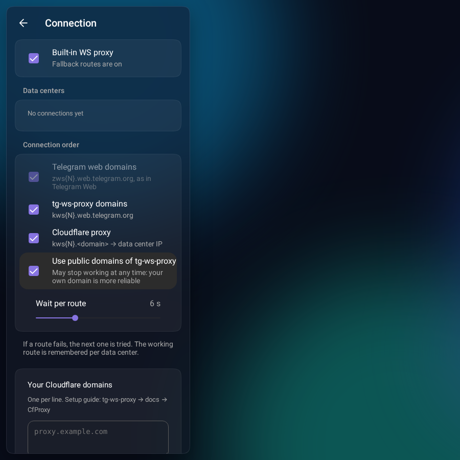
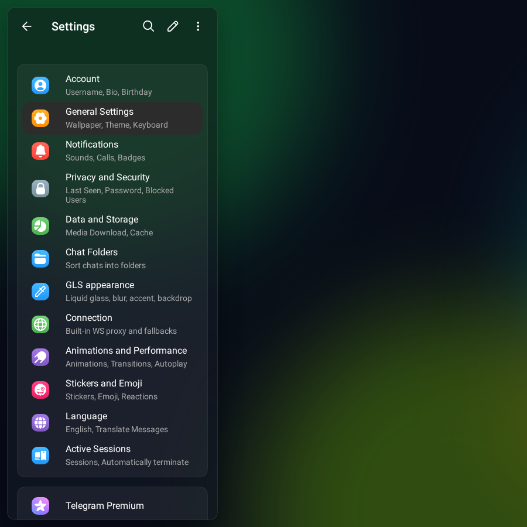

<div align="center">



<br>

[](https://github.com/mantraa0/glass/actions/workflows/build-windows.yml)


**[Скачать](https://github.com/mantraa0/glass/releases/latest)** · **[Возможности](#возможности)** · **[Подключение](#подключение-и-обход-блокировок)** · **[Сборка](#сборка)**

</div>

---

**Telegram GLS** — клиент Telegram для Windows. Интерфейс построен на официальной веб-версии [Telegram Web A](https://github.com/Ajaxy/telegram-tt), поверх добавлен стеклянный дизайн, который настраивается до мелочей. Запасные маршруты подключения из [tg-ws-proxy](https://github.com/Flowseal/tg-ws-proxy) встроены прямо в клиент, без отдельной программы и без настройки прокси.

## Возможности

<table>
<tr>
<td width="50%"></td>
<td width="50%"></td>
</tr>
<tr>
<td><b>Liquid glass.</b> Полупрозрачные панели с размытием и бликами по краям парят над фоном. Есть преломление, как у настоящего стекла.</td>
<td><b>Настраивается всё.</b> Фон, размытие, плотность, насыщенность, скругления, отступы, акцентный цвет и стиль сообщений. Изменения видны сразу.</td>
</tr>
<tr>
<td></td>
<td></td>
</tr>
<tr>
<td><b>Встроенный обход блокировок.</b> Если один маршрут не отвечает, Telegram GLS сам переключается на следующий и запоминает рабочий.</td>
<td><b>Всё из Telegram Web.</b> Папки, темы, реакции, истории, звонки, несколько аккаунтов. Живёт в трее, показывает счётчик непрочитанных.</td>
</tr>
</table>

### Что настраивается

| Раздел | Параметры |
| --- | --- |
| Фон | Сияние, Закат, Океан, Лес, Графит, обои чата Telegram или своё изображение, затемнение |
| Материал | Размытие 0–60 px, плотность панелей, насыщенность, блики по краям, преломление |
| Форма | Скругление углов, отступы между панелями |
| Цвет | 8 готовых акцентов, цвет темы или любой свой |
| Сообщения | Стекло с акцентом, стекло в цветах темы, сплошные как в Telegram |

## Установка

1. Скачайте **Telegram.GLS_x.y.z_x64-setup.exe** из [последнего релиза](https://github.com/mantraa0/glass/releases/latest). Сборки после каждого изменения лежат в [Actions](https://github.com/mantraa0/glass/actions/workflows/build-windows.yml) (артефакт **Telegram-GLS-windows-x64**).
2. Запустите установщик. Права администратора не нужны.
3. Установщик пока не подписан, поэтому Windows SmartScreen предупредит о нём: нажмите **Подробнее → Выполнить в любом случае**.

### Первый запуск

Ключи приложения Telegram (`api_id` и `api_hash`) уже встроены в сборку, поэтому просто войдите в аккаунт по QR-коду или номеру телефона.

Если вы собираете свою версию без ключей, приложение спросит их при первом запуске. Получить свои можно на [my.telegram.org](https://my.telegram.org) → **API development tools**.

## Подключение и обход блокировок

Telegram Web уже работает через WebSocket. Это тот же транспорт, на который tg-ws-proxy переводит Telegram Desktop. Поэтому Telegram GLS не запускает локальный прокси, а сразу пробует цепочку адресов:

```text
zws{N}.web.telegram.org      ← как обычный Telegram Web
kws{N}.web.telegram.org      ← домены tg-ws-proxy
kws{N}.<ваш домен>           ← Cloudflare-прокси (свои и публичные домены)
<worker>.workers.dev         ← Cloudflare Worker, TCP-туннель до дата-центра
```

- Рабочий маршрут запоминается отдельно для каждого дата-центра, следующее подключение начинается с него.
- Список публичных Cloudflare-доменов обновляется из репозитория tg-ws-proxy раз в сутки.
- Свой домен надёжнее публичного. Как его настроить, описано в [инструкции tg-ws-proxy](https://github.com/Flowseal/tg-ws-proxy/blob/main/docs/RU/CfProxy.md). Домен вписывается в **Настройки → Подключение**, там же видно, какой дата-центр через что подключён.

## Сборка

Установщик собирается в GitHub Actions на `windows-latest` при каждом пуше в `main`. Когда в `tauri/tauri.conf.json` появляется новая `version`, сборка сама публикует релиз `v<версия>` с установщиком. Ключи приложения заданы в `.github/workflows/build-windows.yml`. Секреты репозитория `TELEGRAM_API_ID` и `TELEGRAM_API_HASH` переопределяют их.

Локально на Windows (Node.js 24, Rust stable):

```powershell
npm ci
copy .env.example .env    # BASE_URL=http://localhost:47613/  APP_TITLE=Telegram GLS
npm run build:production
npx tauri build --bundles nsis
```

<details>
<summary>Где что лежит</summary>

| Путь | Что там |
| --- | --- |
| `src/styles/glass.scss` | Стеклянный слой поверх стилей Web A |
| `src/util/glass/` | Настройки оформления, фон, акцент, строки RU/EN |
| `src/components/left/settings/SettingsGlass*.tsx` | Экраны «Оформление GLS» и «Подключение» |
| `src/lib/gramjs/extensions/wsRoutes.ts` | Цепочка маршрутов, перенесённая из tg-ws-proxy |
| `src/components/auth/GlassApiSetup.tsx` | Ввод api_id/api_hash для сборок без встроенных ключей |
| `tauri/` | Оболочка: название, иконки, раздача приложения с `localhost:47613`, установщик NSIS |
| `.github/workflows/build-windows.yml` | Сборка установщика |

</details>

## Благодарности

- [Telegram Web A](https://github.com/Ajaxy/telegram-tt) — интерфейс и протокол (GPL-3.0). Исходное описание проекта: [docs/WEB_A_README.md](docs/WEB_A_README.md).
- [tg-ws-proxy](https://github.com/Flowseal/tg-ws-proxy) от Flowseal — схема маршрутов и Cloudflare-фолбэки (MIT).
- [Tauri](https://tauri.app) — десктопная оболочка.

Telegram GLS — неофициальный клиент. Он не связан с Telegram и не одобрен им. Распространяется по лицензии [GPL-3.0](LICENSE).
